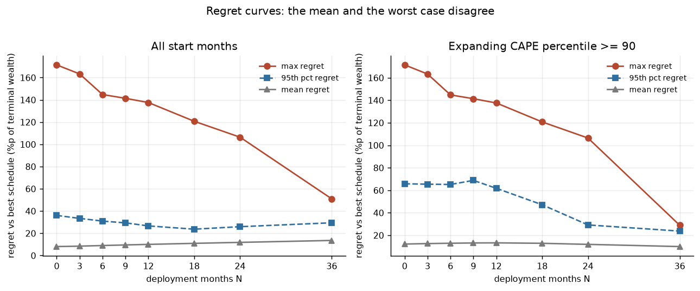
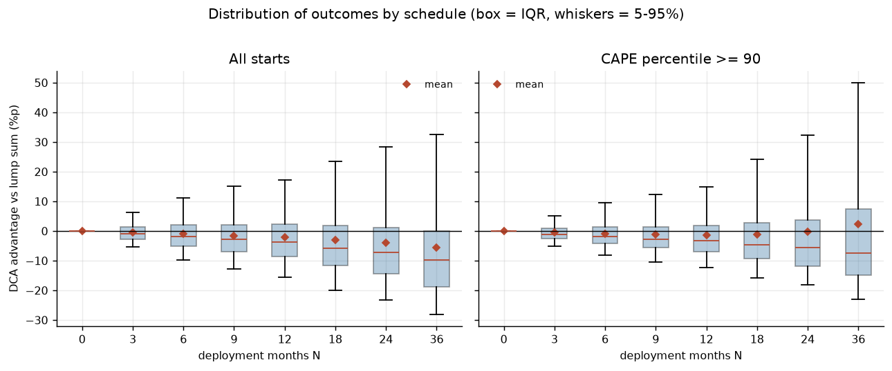
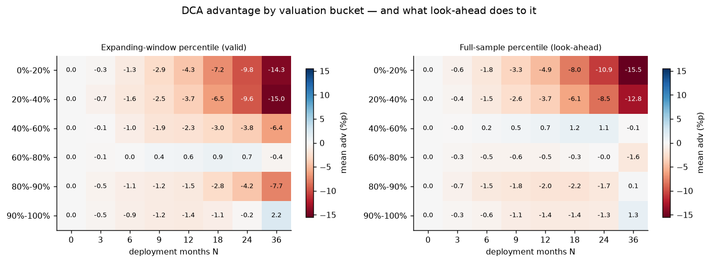
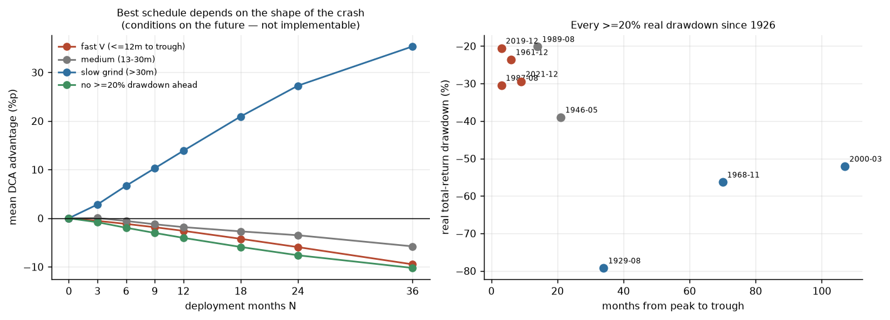
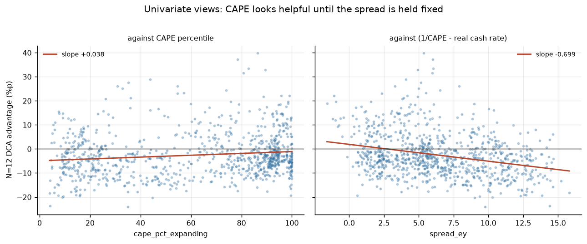
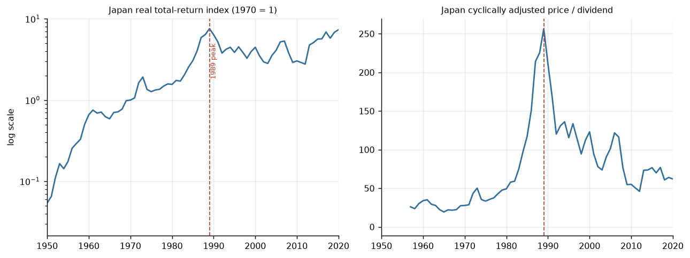

# 고 CAPE 구간 분할매수 스케줄 백테스트 — 결과

_생성: 2026-07-28 · 부트스트랩 2000회, 평균 블록 30개월_

모든 수치는 **실질**(CPI 디플레이트) 기준, 주식 레그는 **총수익**(배당 재투자), 현금 레그는 **French RF**(1개월 T-bill)다.
`DCA advantage` = (N개월 분할 최종부 / 일시투자 최종부 − 1), 단위 %p. 양수면 분할이 유리.


## 요약

**1. 최적 N은? — 표본으로 판별 불가. 점추정은 N=0(일시투자)이다.**
무조건부로는 N이 길수록 단조적으로 나빠진다(N=12: −2.05%p, 95% CI [−3.95, −0.11]). 고밸류에이션 조건부에서는 N=36의 점추정이 +2.2%p로 뒤집히지만 **95% 신뢰구간이 약 ±11%p로 점추정의 5배**이고, 1929년 한 에피소드를 빼면 부호가 바뀐다. 판별 불가다.

**2. CAPE인가 스프레드인가? — 스프레드다. 이것이 이 프로젝트의 결론이다.**
CAPE 백분위 단독 회귀에서는 계수가 양(+0.038, t=1.78)이다. 그러나 (주식 기대수익 − 무위험금리) 스프레드를 함께 넣으면 CAPE 계수는 유의성을 잃는 정도가 아니라 **부호가 뒤집혀 −0.071 (t=−2.50)**이 되고, 스프레드는 t=−4.11로 견고하다. R²는 0.019 → 0.109다. 결정적으로, 스프레드 계수는 **평균 시장 이탈기간에 거의 정확히 비례**한다 — '분할의 비용 = 스프레드 × 이탈기간'이라는 기계적 설명 그대로다. **대안 가설이 지지된다.**

**3. 낙폭 트리거는 개선을 주는가? — 평균은 아니고, 분산은 준다.**
S2는 전체 표본에서 같은 N보다 낫지만(배치를 앞당기므로), 고밸류에이션 구간에서는 오히려 나쁘다(−1.8%p vs +2.2%p). 승률은 0.34→0.40으로 오르고 최대이익은 171%p→36%p로 잘린다. 평균 개선 장치가 아니라 분산 축소 장치다.

**4. 유효표본수와 신뢰구간은? — 조건부 주장의 유효표본은 사실상 에피소드 3개다.**
확장윈도우 CAPE 상위 10% 구간의 시작월 417개는 **서로 겹치지 않는 3개 에피소드**(1928~47, 1961~78, 1993~2026)에서 나온다. N=36 기준 유효표본 16.7이다. N=3(−0.47%p)만 CI가 0을 제외하고, **N>=6은 전부 제외하지 못한다.**

---

**실질적으로 결정을 좌우하는 것** (판별 불가일 때 무엇을 봐야 하는가):

| 요인 | 크기 | 방향 |
|---|---|---|
| 스프레드 × 이탈기간 | N=12에서 약 −1.2%p per 1%p 스프레드 | 분할에 불리 |
| 현재 스프레드 위치 | 2.24% = 역사적 18분위 (CAPE는 99분위) | 거의 무차별 |
| 양도소득세 22% | 전략 간 격차를 약 15% 축소 | 결정을 덜 중요하게 |
| 이자소득 종합과세 49.5% | 세후 격차가 세전보다 확대 | 분할에 불리 |
| 환노출 (원화 대기 vs 달러 대기) | N=12에서 −2.81%p vs −2.28%p | 원화 대기가 불리 |
| 위험예산 (고정혼합 대조군) | γ≥5에서 고정혼합이 분할을 이김 | 분할 대신 비중 축소 |


## 0. 검증 게이트

```
==============================================================================
STEP 2 — VALIDATION GATES
==============================================================================

[PASS] 1. Vanguard 60/40 replication
   target  : win rate ~66.7%, avg excess ~2.3%p
   observed: win rate 66.9%, avg excess 2.24%p

[PASS] 2. Real total-return drawdowns
   target  : differ from -86%/-49%/-57%; difference explained
   observed: see table
  episode known price index DD Shiller monthly-avg price DD nominal total return DD REAL total return DD cumulative CPI over window real trough
1929-1932                 -86%                      -84.76%                 -83.65%              -79.20%                    -24.28%     1932-06
2000-2002                 -49%                      -42.47%                 -44.99%              -47.91%                      6.54%     2002-09
2007-2009                 -57%                      -50.82%                 -50.31%              -51.07%                      3.45%     2009-02

[PASS] 3. CAPE landmarks
   target  : 2026-07 ~41.4, 1999-12 ~44.19
   observed: 2026-07 = 41.37, 1999-12 = 44.20 (all-time high 44.20 at 1999-12)

[PASS] 4. French RF vs FRED TB3MS
   target  : correlation > 0.99
   observed: corr = 0.9921 (TB3MS lagged 1m, the correct alignment) over 1108 months (1934-02..2026-05); contemporaneous 0.9896; DTB3 month-end check 0.9920; mean level gap -10.1bp/yr (1m bill below 3m bill — term premium, expected sign)

ALL GATES PASSED
```


## 1. 구조적 사실: 분할 효과는 배치 기간 안에서 전부 결정된다

마지막 회차가 투입되면 모든 전략이 동일한 100% 주식 포트폴리오를 들고 있다. 따라서 두 전략의 최종부 **비율**은 배치 완료 시점에 고정되고, 이후 보유기간과 무관하다.

- 동일 시작월에서 H=120개월과 H=240개월의 advantage 최대 차이: **3.11e-15** (부동소수점 오차)
- 따라서 (a) 답은 보유기간에 의존하지 않고, (b) advantage의 유효표본은 `관측기간/H`가 아니라 **`관측기간/N`**이며, (c) 시작월을 H개월 앞에서 끊을 이유가 없다.

**(c)가 결정적이다.** 10년 보유를 전제로 표본을 자르면 시작월이 2016-06에서 끝나고, 질문의 대상인 2017~2025 고밸류에이션 구간이 통째로 빠진다. 아래 모든 advantage 분석은 잘린 표본이 아니라 전체 표본을 쓴다.


## 2. 무조건부 결과

|   N |   mean adv (%p) | 95% CI (%p)     |   median (%p) |   P(beat lump) |   start months |   effective N |   regimes | CI excludes 0   | flag   |
|----:|----------------:|:----------------|--------------:|---------------:|---------------:|--------------:|----------:|:----------------|:-------|
|   0 |            0.00 | [+0.00, +0.00]  |          0.00 |           0.00 |           1199 |       1199.00 |         1 | no              |        |
|   3 |           -0.39 | [-0.73, -0.04]  |         -0.97 |           0.38 |           1197 |        399.70 |         1 | yes             |        |
|   6 |           -0.97 | [-1.81, -0.08]  |         -1.93 |           0.35 |           1194 |        199.80 |         1 | yes             |        |
|   9 |           -1.53 | [-2.89, -0.12]  |         -2.88 |           0.33 |           1191 |        133.20 |         1 | yes             |        |
|  12 |           -2.05 | [-3.95, -0.11]  |         -3.83 |           0.31 |           1188 |         99.90 |         1 | yes             |        |
|  18 |           -2.99 | [-6.03, +0.10]  |         -5.81 |           0.29 |           1182 |         66.60 |         1 | no              |        |
|  24 |           -3.87 | [-8.05, +0.37]  |         -7.26 |           0.27 |           1176 |         50.00 |         1 | no              |        |
|  36 |           -5.50 | [-11.97, +1.10] |         -9.79 |           0.25 |           1164 |         33.30 |         1 | no              |        |

일시투자가 이긴다. N이 길수록 단조적으로 나빠지고, N=3~12는 신뢰구간이 0을 제외한다. N>=18은 제외하지 못한다.


### 2.1 시작연도 민감도

|   start year |   start months |   eff N (N=12) |   best N |   N=0 |   N=3 |   N=6 |   N=9 |   N=12 |   N=18 |   N=24 |   N=36 |
|-------------:|---------------:|---------------:|---------:|------:|------:|------:|------:|-------:|-------:|-------:|-------:|
|         1926 |        1199.00 |          99.90 |     0.00 |  0.00 | -0.39 | -0.97 | -1.53 |  -2.05 |  -2.99 |  -3.87 |  -5.50 |
|         1950 |         917.00 |          76.40 |     0.00 |  0.00 | -0.48 | -1.20 | -1.89 |  -2.57 |  -3.85 |  -5.13 |  -7.55 |
|         1970 |         677.00 |          56.40 |     0.00 |  0.00 | -0.40 | -1.01 | -1.64 |  -2.25 |  -3.41 |  -4.54 |  -6.66 |
|         1990 |         437.00 |          36.40 |     0.00 |  0.00 | -0.53 | -1.36 | -2.17 |  -2.96 |  -4.47 |  -5.93 |  -8.52 |

1926/1950/1970/1990 어느 시작점에서도 최적 N은 0이다. 체리피킹으로 뒤집히지 않는다.


## 3. 밸류에이션 조건부 결과

| CAPE pct bucket   |   start months |   regimes |   eff N (N=12) |   best N |   N=0 |   N=3 |   N=6 |   N=9 |   N=12 |   N=18 |   N=24 |   N=36 | flag   |
|:------------------|---------------:|----------:|---------------:|---------:|------:|------:|------:|------:|-------:|-------:|-------:|-------:|:-------|
| 0%-20%            |            175 |         3 |          21.90 |        0 |  0.00 | -0.26 | -1.34 | -2.85 |  -4.34 |  -7.25 |  -9.84 | -14.28 |        |
| 20%-40%           |            188 |         4 |          29.70 |        0 |  0.00 | -0.71 | -1.57 | -2.48 |  -3.74 |  -6.48 |  -9.64 | -14.98 |        |
| 40%-60%           |            125 |         5 |          26.10 |        0 |  0.00 | -0.06 | -1.00 | -1.94 |  -2.29 |  -2.95 |  -3.78 |  -6.37 |        |
| 60%-80%           |            154 |         6 |          31.20 |       18 |  0.00 | -0.13 |  0.03 |  0.43 |   0.59 |   0.94 |   0.73 |  -0.42 |        |
| 80%-90%           |            140 |         5 |          28.90 |        0 |  0.00 | -0.50 | -1.07 | -1.25 |  -1.52 |  -2.81 |  -4.23 |  -7.69 |        |
| 90%-100%          |            417 |         5 |          42.00 |       36 |  0.00 | -0.47 | -0.87 | -1.24 |  -1.39 |  -1.07 |  -0.16 |   2.22 |        |

상위 10% 구간에서만 N=36이 평균적으로 앞선다(+2.2%p). 그런데 바로 아래 80~90% 구간은 N=36이 −7.7%p로 최악이다. 단조적이지 않다는 것은 신호가 아니라 잡음이라는 뜻이다.


### 3.1 상위 10% 구간 상세 (부트스트랩 CI 포함)

|   N |   mean adv (%p) | 95% CI (%p)      |   median (%p) |   P(beat lump) |   start months |   effective N |   regimes | CI excludes 0   | flag   |
|----:|----------------:|:-----------------|--------------:|---------------:|---------------:|--------------:|----------:|:----------------|:-------|
|   0 |            0.00 | [+0.00, +0.00]   |          0.00 |           0.00 |            417 |        417.00 |         5 | no              |        |
|   3 |           -0.47 | [-0.89, -0.01]   |         -1.06 |           0.34 |            415 |        148.00 |         5 | yes             |        |
|   6 |           -0.87 | [-1.96, +0.33]   |         -1.93 |           0.33 |            412 |         77.80 |         5 | no              |        |
|   9 |           -1.24 | [-3.03, +0.76]   |         -2.73 |           0.32 |            409 |         54.00 |         5 | no              |        |
|  12 |           -1.39 | [-3.98, +1.39]   |         -3.26 |           0.30 |            406 |         42.00 |         5 | no              |        |
|  18 |           -1.07 | [-5.73, +3.33]   |         -4.76 |           0.33 |            400 |         29.40 |         5 | no              |        |
|  24 |           -0.16 | [-7.54, +6.13]   |         -5.57 |           0.31 |            394 |         23.00 |         5 | no              |        |
|  36 |            2.22 | [-11.39, +12.07] |         -7.50 |           0.34 |            382 |         16.70 |         5 | no              |        |

**N=3을 빼면 어떤 N도 신뢰구간이 0을 제외하지 못한다.** 그리고 CI를 제외하는 그 N=3은 분할이 *불리하다*는 쪽이다. N=36의 점추정 +2.2%p에 대한 95% 구간은 약 [−11.4, +12.1]로 점추정의 5배 폭이며, 부호조차 결정되지 않는다.


### 3.2 확장윈도우 vs 전체표본 백분위 (look-ahead 편향의 크기)

| CAPE pct bucket   |   start months (expanding) |   start months (full-sample) |   N=0 |   N=3 |   N=6 |   N=9 |   N=12 |   N=18 |   N=24 |   N=36 |   best N expanding |   best N full-sample |
|:------------------|---------------------------:|-----------------------------:|------:|------:|------:|------:|-------:|-------:|-------:|-------:|-------------------:|---------------------:|
| 0%-20%            |                     175.00 |                       220.00 |  0.00 | -0.35 | -0.46 | -0.43 |  -0.56 |  -0.74 |  -1.03 |  -1.18 |               0.00 |                 0.00 |
| 20%-40%           |                     188.00 |                       218.00 |  0.00 |  0.30 |  0.09 | -0.13 |   0.05 |   0.38 |   1.11 |   2.17 |               0.00 |                 0.00 |
| 40%-60%           |                     125.00 |                       171.00 |  0.00 |  0.05 |  1.20 |  2.41 |   3.03 |   4.14 |   4.88 |   6.30 |               0.00 |                18.00 |
| 60%-80%           |                     154.00 |                       251.00 |  0.00 | -0.18 | -0.54 | -0.98 |  -1.12 |  -1.24 |  -0.76 |  -1.19 |              18.00 |                 0.00 |
| 80%-90%           |                     140.00 |                       166.00 |  0.00 | -0.21 | -0.42 | -0.54 |  -0.43 |   0.65 |   2.55 |   7.83 |               0.00 |                36.00 |
| 90%-100%          |                     417.00 |                       173.00 |  0.00 |  0.16 |  0.28 |  0.16 |   0.04 |  -0.30 |  -1.17 |  -0.90 |              36.00 |                36.00 |

표의 값은 `전체표본 백분위 결과 − 확장윈도우 백분위 결과`다. 40~60% 구간에서 최대 +6.3%p, 80~90% 구간에서 +7.8%p가 창출된다. 버킷 소속 자체도 바뀐다 — 상위 10% 구간의 시작월 수가 417개월에서 173개월로 줄어든다. 문헌에서 흔한 이 편향은 실제 효과 크기(수 %p)와 같은 자릿수다.


### 3.3 에피소드 leave-one-out

**전체 시작월**

| N      |   full sample |   ex-1929 |   ex-2000 |   ex-2008 |   ex-2020 |
|:-------|--------------:|----------:|----------:|----------:|----------:|
| 0      |          0.00 |      0.00 |      0.00 |      0.00 |      0.00 |
| 3      |         -0.39 |     -0.55 |     -0.46 |     -0.44 |     -0.38 |
| 6      |         -0.97 |     -1.36 |     -1.12 |     -1.10 |     -0.93 |
| 9      |         -1.53 |     -2.13 |     -1.78 |     -1.72 |     -1.45 |
| 12     |         -2.05 |     -2.85 |     -2.37 |     -2.29 |     -1.93 |
| 18     |         -2.99 |     -4.23 |     -3.41 |     -3.34 |     -2.79 |
| 24     |         -3.87 |     -5.55 |     -4.41 |     -4.32 |     -3.60 |
| 36     |         -5.50 |     -8.11 |     -6.16 |     -6.06 |     -5.05 |
| best N |          0.00 |      0.00 |      0.00 |      0.00 |      0.00 |

**고밸류에이션(>=80분위) 시작월만**

| N      |   full sample |   ex-1929 |   ex-2000 |   ex-2008 |   ex-2020 |
|:-------|--------------:|----------:|----------:|----------:|----------:|
| 0      |          0.00 |      0.00 |      0.00 |      0.00 |      0.00 |
| 3      |         -0.48 |     -0.58 |     -0.62 |     -0.52 |     -0.45 |
| 6      |         -0.92 |     -1.17 |     -1.26 |     -1.10 |     -0.83 |
| 9      |         -1.25 |     -1.63 |     -1.77 |     -1.60 |     -1.06 |
| 12     |         -1.43 |     -1.95 |     -2.10 |     -1.94 |     -1.12 |
| 18     |         -1.52 |     -2.58 |     -2.34 |     -2.33 |     -0.99 |
| 24     |         -1.22 |     -3.40 |     -2.18 |     -2.20 |     -0.42 |
| 36     |         -0.44 |     -5.30 |     -1.22 |     -1.47 |      1.14 |
| best N |          0.00 |      0.00 |      0.00 |      0.00 |     36.00 |

고밸류에이션 부분표본에서 최적 N은 전체·ex-1929·ex-2000·ex-2008에서 모두 0이지만 ex-2020에서 36으로 바뀐다. 단일 에피소드로 뒤집히는 결론은 결론이 아니다.


### 3.4 후회 행렬과 minimax

**전체 시작월**

|   N |   max regret (%p) |   mean regret (%p) |   p95 regret (%p) |   times best |   share best |
|----:|------------------:|-------------------:|------------------:|-------------:|-------------:|
|   0 |            171.44 |               8.07 |             36.10 |       513.00 |         0.44 |
|   3 |            163.31 |               8.45 |             33.40 |       153.00 |         0.13 |
|   6 |            144.78 |               9.00 |             30.98 |        84.00 |         0.07 |
|   9 |            141.38 |               9.53 |             29.38 |        63.00 |         0.05 |
|  12 |            137.60 |              10.03 |             26.65 |        66.00 |         0.06 |
|  18 |            120.74 |              10.96 |             23.70 |        82.00 |         0.07 |
|  24 |            106.43 |              11.84 |             25.95 |        74.00 |         0.06 |
|  36 |             50.99 |              13.58 |             29.45 |       129.00 |         0.11 |

minimax N = **36**, mean-regret 최소 N = **0**

**상위 10% 밸류에이션**

|   N |   max regret (%p) |   mean regret (%p) |   p95 regret (%p) |   times best |   share best |
|----:|------------------:|-------------------:|------------------:|-------------:|-------------:|
|   0 |            171.44 |              12.20 |             65.77 |       155.00 |         0.41 |
|   3 |            163.31 |              12.63 |             65.43 |        41.00 |         0.11 |
|   6 |            144.78 |              12.93 |             65.16 |        20.00 |         0.05 |
|   9 |            141.38 |              13.19 |             68.80 |        14.00 |         0.04 |
|  12 |            137.60 |              13.28 |             61.77 |        17.00 |         0.04 |
|  18 |            120.74 |              12.88 |             47.15 |        22.00 |         0.06 |
|  24 |            106.43 |              11.93 |             29.20 |        27.00 |         0.07 |
|  36 |             28.95 |               9.98 |             23.74 |        86.00 |         0.23 |

minimax N = **36**, mean-regret 최소 N = **36**

여기서 평균과 최악값이 갈린다. 평균은 일시투자, 최대후회 기준은 N=36이다(최대후회 171%p → 29%p). 이 둘은 서로 다른 질문에 대한 답이며 어느 쪽도 틀리지 않았다.


### 3.5 크래시 모양별 (사후 조건부, 실행 불가)

| crash shape              |   start months |   episodes |   best N |   N=0 |   N=3 |   N=6 |   N=9 |   N=12 |   N=18 |   N=24 |   N=36 |
|:-------------------------|---------------:|-----------:|---------:|------:|------:|------:|------:|-------:|-------:|-------:|-------:|
| fast V (<=12m to trough) |         139.00 |       4.00 |     0.00 |  0.00 | -0.53 | -1.16 | -1.85 |  -2.59 |  -4.23 |  -5.94 |  -9.48 |
| medium (13-30m)          |          74.00 |       2.00 |     3.00 |  0.00 |  0.04 | -0.56 | -1.24 |  -1.82 |  -2.70 |  -3.50 |  -5.78 |
| slow grind (>30m)        |         111.00 |       3.00 |    36.00 |  0.00 |  2.83 |  6.68 | 10.28 |  13.88 |  20.93 |  27.27 |  35.34 |
| no >=20% drawdown ahead  |         875.00 |       0.00 |     0.00 |  0.00 | -0.82 | -1.95 | -3.02 |  -4.03 |  -5.91 |  -7.62 | -10.22 |

**탐지된 실질 총수익 기준 20% 이상 낙폭 에피소드**

|    | peak    | trough   | recovered   |   depth |   months_to_trough |   months_to_recover | shape                    |
|---:|:--------|:---------|:------------|--------:|-------------------:|--------------------:|:-------------------------|
|  0 | 1929-08 | 1932-06  | 1945-02     |  -79.20 |                 34 |                 152 | slow grind (>30m)        |
|  1 | 1946-05 | 1948-02  | 1951-01     |  -38.98 |                 21 |                  35 | medium (13-30m)          |
|  2 | 1961-12 | 1962-06  | 1963-05     |  -23.58 |                  6 |                  11 | fast V (<=12m to trough) |
|  3 | 1968-11 | 1974-09  | 1983-04     |  -56.29 |                 70 |                 103 | slow grind (>30m)        |
|  4 | 1987-08 | 1987-11  | 1989-07     |  -30.46 |                  3 |                  20 | fast V (<=12m to trough) |
|  5 | 1989-08 | 1990-10  | 1991-03     |  -20.11 |                 14 |                   5 | medium (13-30m)          |
|  6 | 2000-03 | 2009-02  | 2013-02     |  -52.06 |                107 |                  48 | slow grind (>30m)        |
|  7 | 2019-12 | 2020-03  | 2020-07     |  -20.55 |                  3 |                   4 | fast V (<=12m to trough) |
|  8 | 2021-12 | 2022-09  | 2024-06     |  -29.40 |                  9 |                  21 | fast V (<=12m to trough) |

가설이 정확히 확인된다. 느린 하락(>30개월)에서는 N=36이 +35%p, 빠른 V자에서는 −9.5%p다. 이 둘이 상쇄되어 평균이 0 근처로 뭉개진다. **다만 이 표는 미래를 알아야 쓸 수 있다.**


### 3.6 CRRA 확실성등가

**전체 시작월** (H=120개월, n=1080, 1926-07..2016-06)

|   gamma |   best N |   N=0 |    N=3 |    N=6 |    N=9 |   N=12 |   N=18 |   N=24 |   N=36 |
|--------:|---------:|------:|-------:|-------:|-------:|-------:|-------:|-------:|-------:|
|       1 |    0.000 | 0.000 | -0.433 | -1.092 | -1.749 | -2.398 | -3.649 | -4.858 | -7.177 |
|       3 |    0.000 | 0.000 | -0.049 | -0.177 | -0.301 | -0.432 | -0.609 | -0.580 | -0.461 |
|       5 |   36.000 | 0.000 |  0.001 | -0.001 |  0.065 |  0.094 |  0.367 |  1.360 |  3.607 |
|      10 |   36.000 | 0.000 | -0.359 | -0.692 | -0.790 | -1.209 | -1.688 | -0.237 |  3.398 |

**expanding CAPE percentile >= 90** (H=120개월, n=300, 1928-03..2016-06)

|   gamma |   best N |   N=0 |    N=3 |    N=6 |    N=9 |   N=12 |   N=18 |   N=24 |   N=36 |
|--------:|---------:|------:|-------:|-------:|-------:|-------:|-------:|-------:|-------:|
|       1 |   36.000 | 0.000 | -0.395 | -0.601 | -0.753 | -0.718 | -0.127 |  0.795 |  2.408 |
|       3 |   36.000 | 0.000 | -0.244 | -0.221 | -0.176 |  0.027 |  0.778 |  2.117 |  4.751 |
|       5 |   36.000 | 0.000 | -0.295 | -0.308 | -0.310 | -0.267 |  0.079 |  1.587 |  4.866 |
|      10 |   36.000 | 0.000 | -0.650 | -1.019 | -1.244 | -1.839 | -2.722 | -1.322 |  2.372 |

주의: CRRA는 실제 보유기간이 필요하므로 H=120개월을 쓴다. 그 결과 시작월이 2016-06에서 끊기고, **일시투자에 가장 유리했던 2017~2025 구간이 빠진다.** 아래 통제를 반드시 함께 보라.


### 3.7 결정적 통제: 이건 타이밍 문제인가, 위험예산 문제인가

**전체 시작월** (n=1080, 1926-07..2016-06)

|   N |   avg equity weight |   mean adv of DCA vs lump (%p) |   mean adv of static vs lump (%p) |   CE(DCA)-CE(static) g=1 (%) |   CE(DCA)-CE(static) g=3 (%) |   CE(DCA)-CE(static) g=5 (%) |   CE(DCA)-CE(static) g=10 (%) |
|----:|--------------------:|-------------------------------:|----------------------------------:|-----------------------------:|-----------------------------:|-----------------------------:|------------------------------:|
|   0 |               1.000 |                          0.000 |                             0.000 |                        0.000 |                        0.000 |                        0.000 |                         0.000 |
|   3 |               0.988 |                         -0.346 |                            -0.635 |                        0.205 |                       -0.049 |                       -0.390 |                        -0.964 |
|   6 |               0.975 |                         -0.845 |                            -1.265 |                        0.186 |                       -0.160 |                       -0.765 |                        -1.882 |
|   9 |               0.963 |                         -1.327 |                            -1.892 |                        0.168 |                       -0.250 |                       -1.054 |                        -2.551 |
|  12 |               0.950 |                         -1.782 |                            -2.514 |                        0.159 |                       -0.333 |                       -1.364 |                        -3.518 |
|  18 |               0.925 |                         -2.609 |                            -3.748 |                        0.192 |                       -0.366 |                       -1.721 |                        -5.049 |
|  24 |               0.900 |                         -3.382 |                            -4.966 |                        0.272 |                       -0.129 |                       -1.312 |                        -4.675 |
|  36 |               0.850 |                         -4.918 |                            -7.359 |                        0.550 |                        0.598 |                       -0.065 |                        -3.170 |

**expanding CAPE percentile >= 90** (n=300, 1928-03..2016-06)

|   N |   avg equity weight |   mean adv of DCA vs lump (%p) |   mean adv of static vs lump (%p) |   CE(DCA)-CE(static) g=1 (%) |   CE(DCA)-CE(static) g=3 (%) |   CE(DCA)-CE(static) g=5 (%) |   CE(DCA)-CE(static) g=10 (%) |
|----:|--------------------:|-------------------------------:|----------------------------------:|-----------------------------:|-----------------------------:|-----------------------------:|------------------------------:|
|   0 |               1.000 |                          0.000 |                             0.000 |                        0.000 |                        0.000 |                        0.000 |                         0.000 |
|   3 |               0.988 |                         -0.336 |                            -0.100 |                       -0.293 |                       -0.570 |                       -0.835 |                        -1.312 |
|   6 |               0.975 |                         -0.429 |                            -0.202 |                       -0.391 |                       -0.860 |                       -1.371 |                        -2.321 |
|   9 |               0.963 |                         -0.471 |                            -0.304 |                       -0.429 |                       -1.113 |                       -1.880 |                        -3.169 |
|  12 |               0.950 |                         -0.290 |                            -0.408 |                       -0.275 |                       -1.196 |                       -2.330 |                        -4.361 |
|  18 |               0.925 |                          0.795 |                            -0.619 |                        0.577 |                       -0.986 |                       -2.929 |                        -6.386 |
|  24 |               0.900 |                          2.590 |                            -0.835 |                        1.791 |                       -0.153 |                       -2.358 |                        -6.167 |
|  36 |               0.850 |                          6.271 |                            -1.283 |                        4.073 |                        1.594 |                       -0.864 |                        -4.843 |

N개월 분할은 기간의 일부를 저위험으로 보낸다. 위험회피적 기준이 이를 선호하는 것은 당연하며, 그것은 타이밍에 대한 진술이 아니라 **위험예산에 대한 진술**이다. 올바른 대조군은 같은 평균 주식비중을 가진 고정혼합이다.

고밸류에이션 구간에서 N=36의 평균 우위(+2.2%p)는 같은 평균비중(85%) 고정혼합 대비로는 사라지고, γ=5·γ=10에서는 **고정혼합이 이긴다**. 위험을 줄이고 싶다면 배치를 늦추는 것보다 주식비중을 영구적으로 낮추는 편이 낫다.


### 3.8 주식비중 사다리 — 실제로 큰 레버

**전체 시작월** (n=1080, 유효표본 10.0, 1926-07..2016-06)

|   equity weight |   mean |   p05 |   p50 |   p95 |   min |   loss rate |   CE g=1 |   CE g=3 |   CE g=5 |   CE g=10 |
|----------------:|-------:|------:|------:|------:|------:|------------:|---------:|---------:|---------:|----------:|
|           1.000 |  2.172 | 0.776 | 2.112 | 3.812 | 0.600 |       0.124 |    1.956 |    1.527 |    1.238 |     0.958 |
|           0.850 |  1.950 | 0.819 | 1.921 | 3.197 | 0.665 |       0.116 |    1.806 |    1.511 |    1.283 |     1.022 |
|           0.700 |  1.749 | 0.861 | 1.745 | 2.685 | 0.732 |       0.113 |    1.655 |    1.462 |    1.298 |     1.074 |
|           0.500 |  1.509 | 0.897 | 1.484 | 2.148 | 0.805 |       0.135 |    1.458 |    1.354 |    1.259 |     1.106 |

**expanding CAPE percentile >= 90** (n=300, 유효표본 3.5, 1928-03..2016-06)

|   equity weight |   mean |   p05 |   p50 |   p95 |   min |   loss rate |   CE g=1 |   CE g=3 |   CE g=5 |   CE g=10 |
|----------------:|-------:|------:|------:|------:|------:|------------:|---------:|---------:|---------:|----------:|
|           1.000 |  1.429 | 0.722 | 1.412 | 2.485 | 0.600 |       0.297 |    1.318 |    1.125 |    0.998 |     0.854 |
|           0.850 |  1.371 | 0.773 | 1.380 | 2.161 | 0.665 |       0.267 |    1.297 |    1.160 |    1.055 |     0.919 |
|           0.700 |  1.312 | 0.823 | 1.364 | 1.877 | 0.732 |       0.253 |    1.266 |    1.174 |    1.095 |     0.975 |
|           0.500 |  1.233 | 0.873 | 1.289 | 1.584 | 0.805 |       0.253 |    1.210 |    1.162 |    1.116 |     1.030 |

1.0 대비 배수, 10년 실질, 매월 재조정. 평균은 주식비중에 단조 증가하지만 **확실성등가는 그렇지 않다** — γ=5에서 최대는 70%이고, γ=10에서 100% 주식의 확실성등가는 1을 밑돈다. 분할 개월 수와 달리 이 표의 방향은 부호가 뒤집히지 않는다.


### 3.9 최종부의 분포 — 평균이 아니라 꼬리

**전체 시작월** (n=1080, 유효표본 10.0)

|   N |   p05 |   p25 |   p50 |   p75 |   p95 |   min |   mean |   loss rate |
|----:|------:|------:|------:|------:|------:|------:|-------:|------------:|
|   0 | 0.776 | 1.448 | 2.112 | 2.771 | 3.812 | 0.600 |  2.172 |       0.124 |
|   3 | 0.774 | 1.464 | 2.105 | 2.739 | 3.736 | 0.579 |  2.159 |       0.124 |
|   6 | 0.773 | 1.477 | 2.077 | 2.723 | 3.701 | 0.569 |  2.139 |       0.124 |
|   9 | 0.777 | 1.491 | 2.067 | 2.688 | 3.646 | 0.570 |  2.120 |       0.126 |
|  12 | 0.784 | 1.507 | 2.055 | 2.653 | 3.598 | 0.557 |  2.101 |       0.129 |
|  18 | 0.800 | 1.484 | 2.048 | 2.605 | 3.563 | 0.544 |  2.064 |       0.131 |
|  24 | 0.816 | 1.441 | 2.003 | 2.554 | 3.516 | 0.548 |  2.028 |       0.130 |
|  36 | 0.834 | 1.386 | 1.938 | 2.437 | 3.375 | 0.592 |  1.961 |       0.113 |

**expanding CAPE percentile >= 90** (n=300, 유효표본 3.5)

|   N |   p05 |   p25 |   p50 |   p75 |   p95 |   min |   mean |   loss rate |
|----:|------:|------:|------:|------:|------:|------:|-------:|------------:|
|   0 | 0.722 | 0.884 | 1.412 | 1.794 | 2.485 | 0.600 |  1.429 |       0.297 |
|   3 | 0.720 | 0.898 | 1.392 | 1.773 | 2.458 | 0.579 |  1.422 |       0.297 |
|   6 | 0.711 | 0.926 | 1.417 | 1.750 | 2.442 | 0.569 |  1.416 |       0.300 |
|   9 | 0.709 | 0.920 | 1.426 | 1.739 | 2.431 | 0.570 |  1.412 |       0.303 |
|  12 | 0.703 | 0.922 | 1.443 | 1.739 | 2.434 | 0.557 |  1.409 |       0.303 |
|  18 | 0.700 | 0.924 | 1.453 | 1.696 | 2.457 | 0.544 |  1.414 |       0.290 |
|  24 | 0.713 | 0.959 | 1.424 | 1.690 | 2.427 | 0.548 |  1.424 |       0.273 |
|  36 | 0.750 | 1.029 | 1.389 | 1.703 | 2.350 | 0.592 |  1.441 |       0.233 |

조건부 표들이 보고하는 것은 스케줄 간 평균 *차이*다. 이 표는 각 스케줄이 실제로 마주하는 결과의 폭이다. 고 CAPE 진입의 10년 실질 손실 확률은 일시불 29.7%, N=36에서도 23.3%로 남는다 — 분할은 위험을 제거하지 않는다.


## 4. 전략 S0~S4 비교

**전체 시작월**

|                                                             |   mean adv (%p) |   median (%p) |   P(beat lump) |   worst (%p) |   best (%p) |   start months |
|:------------------------------------------------------------|----------------:|--------------:|---------------:|-------------:|------------:|---------------:|
| ('S0 lump sum', 'N=0')                                      |            0.00 |          0.00 |         nan    |         0.00 |        0.00 |         nan    |
| ('S1 equal DCA', 'N=6')                                     |           -0.97 |         -1.93 |           0.35 |       -34.33 |       41.35 |        1194.00 |
| ('S1 equal DCA', 'N=12')                                    |           -2.05 |         -3.83 |           0.31 |       -38.97 |       80.13 |        1188.00 |
| ('S1 equal DCA', 'N=24')                                    |           -3.87 |         -7.26 |           0.27 |       -46.57 |      111.32 |        1176.00 |
| ('S1 equal DCA', 'N=36')                                    |           -5.50 |         -9.79 |           0.25 |       -50.22 |      171.44 |        1164.00 |
| ('S2 DCA + drawdown accel', 'N=12')                         |           -1.97 |         -3.64 |           0.33 |       -37.43 |       39.19 |        1188.00 |
| ('S2 DCA + drawdown accel', 'N=24')                         |           -3.71 |         -5.30 |           0.34 |       -39.67 |       44.04 |        1176.00 |
| ('S2 DCA + drawdown accel', 'N=36')                         |           -4.91 |         -6.67 |           0.34 |       -40.83 |       45.92 |        1164.00 |
| ('S4 value averaging', 'N=12')                              |           -2.21 |         -3.84 |           0.31 |       -39.07 |       73.87 |        1188.00 |
| ('S4 value averaging', 'N=24')                              |           -4.45 |         -7.19 |           0.27 |       -46.91 |      114.19 |        1176.00 |
| ('S3 wait for valuation', 'CAPE pct < 30%, give up at 36m') |           -6.01 |         -5.01 |           0.22 |       -50.28 |      133.87 |        1164.00 |
| ('S3 wait for valuation', 'CAPE pct < 50%, give up at 36m') |           -3.98 |          0.00 |           0.21 |       -48.86 |      116.60 |        1164.00 |
| ('S3 wait for valuation', 'CAPE pct < 80%, give up at 36m') |           -4.10 |          0.00 |           0.15 |       -48.86 |       91.73 |        1164.00 |

**expanding CAPE percentile >= 90**

|                                                             |   mean adv (%p) |   median (%p) |   P(beat lump) |   worst (%p) |   best (%p) |   start months |
|:------------------------------------------------------------|----------------:|--------------:|---------------:|-------------:|------------:|---------------:|
| ('S0 lump sum', 'N=0')                                      |            0.00 |          0.00 |         nan    |         0.00 |        0.00 |         nan    |
| ('S1 equal DCA', 'N=6')                                     |           -0.87 |         -1.93 |           0.33 |       -13.50 |       30.13 |         412.00 |
| ('S1 equal DCA', 'N=12')                                    |           -1.39 |         -3.26 |           0.30 |       -19.39 |       36.10 |         406.00 |
| ('S1 equal DCA', 'N=24')                                    |           -0.16 |         -5.57 |           0.31 |       -27.32 |      111.32 |         394.00 |
| ('S1 equal DCA', 'N=36')                                    |            2.22 |         -7.50 |           0.34 |       -27.76 |      171.44 |         382.00 |
| ('S2 DCA + drawdown accel', 'N=12')                         |           -1.40 |         -3.16 |           0.33 |       -19.39 |       32.14 |         406.00 |
| ('S2 DCA + drawdown accel', 'N=24')                         |           -1.84 |         -3.77 |           0.37 |       -27.32 |       35.38 |         394.00 |
| ('S2 DCA + drawdown accel', 'N=36')                         |           -1.84 |         -3.64 |           0.40 |       -28.08 |       36.46 |         382.00 |
| ('S4 value averaging', 'N=12')                              |           -1.44 |         -3.20 |           0.31 |       -19.73 |       36.93 |         406.00 |
| ('S4 value averaging', 'N=24')                              |           -1.06 |         -5.48 |           0.32 |       -28.10 |       82.17 |         394.00 |
| ('S3 wait for valuation', 'CAPE pct < 30%, give up at 36m') |           -2.66 |        -15.67 |           0.32 |       -48.86 |      133.87 |         382.00 |
| ('S3 wait for valuation', 'CAPE pct < 50%, give up at 36m') |           -2.82 |        -15.67 |           0.32 |       -48.86 |      116.60 |         382.00 |
| ('S3 wait for valuation', 'CAPE pct < 80%, give up at 36m') |           -8.20 |        -14.36 |           0.33 |       -48.86 |       91.73 |         382.00 |

**S2(낙폭 가속)** — 전체 표본에서는 같은 N의 단순 균등분할보다 낫다(N=36: −4.9%p vs −5.5%p). 배치를 앞당기기 때문이며, 이 논리를 끝까지 밀면 N=0이다. 그러나 고밸류에이션 구간에서는 **오히려 나쁘다** (N=36: −1.8%p vs +2.2%p). 트리거가 1930~31년처럼 −10%/−20%/−30%를 차례로 뚫고 계속 내려가는 국면에서 잔여 현금을 너무 일찍 소진하기 때문이다. 대신 승률은 0.34 → 0.40으로 오르고 최대이익은 171%p → 36%p로 잘린다. S2는 평균을 개선하는 장치가 아니라 **분산을 줄이는 장치**다.

**S3(밸류에이션 대기)** — 반례로서 의도대로 실패한다. 모든 임계값에서, 고밸류에이션 부분표본에서도 음수다(−2.7 ~ −8.2%p). 중앙값은 −15%p로 더 나쁘다.

**S4(밸류평균법)** — S1과 구분되지 않으며 약간 더 나쁘다.


## 5. 회귀 경마 — CAPE인가 스프레드인가

**N=12** (Newey-West lag=120, n=900)

| spec            |    n obs |   effective N |     R2 |   beta cape_pct_expanding |   t cape_pct_expanding |   beta spread_ey |   t spread_ey |   beta vol_trailing |   t vol_trailing |
|:----------------|---------:|--------------:|-------:|--------------------------:|-----------------------:|-----------------:|--------------:|--------------------:|-----------------:|
| (1) CAPE only   | 900.0000 |        7.5000 | 0.0191 |                    0.0383 |                 1.7792 |         nan      |      nan      |            nan      |         nan      |
| (2) spread only | 900.0000 |        7.5000 | 0.0853 |                  nan      |               nan      |          -0.6992 |       -4.2102 |            nan      |         nan      |
| (3) both        | 900.0000 |        7.5000 | 0.1093 |                   -0.0708 |                -2.4954 |          -1.1855 |       -4.1084 |            nan      |         nan      |
| (4) both + vol  | 900.0000 |        7.5000 | 0.1109 |                   -0.0666 |                -2.3050 |          -1.1798 |       -3.9559 |              0.1016 |           0.4989 |

**N=24** (Newey-West lag=120, n=900)

| spec            |    n obs |   effective N |     R2 |   beta cape_pct_expanding |   t cape_pct_expanding |   beta spread_ey |   t spread_ey |   beta vol_trailing |   t vol_trailing |
|:----------------|---------:|--------------:|-------:|--------------------------:|-----------------------:|-----------------:|--------------:|--------------------:|-----------------:|
| (1) CAPE only   | 900.0000 |        7.5000 | 0.0510 |                    0.0896 |                 2.0626 |         nan      |      nan      |            nan      |         nan      |
| (2) spread only | 900.0000 |        7.5000 | 0.1626 |                  nan      |               nan      |          -1.3810 |       -4.2176 |            nan      |         nan      |
| (3) both        | 900.0000 |        7.5000 | 0.1870 |                   -0.1021 |                -2.4976 |          -2.0821 |       -4.4832 |            nan      |         nan      |
| (4) both + vol  | 900.0000 |        7.5000 | 0.1906 |                   -0.0928 |                -2.1747 |          -2.0696 |       -4.1378 |              0.2220 |           0.5164 |

**요약 (E[equity] 정의 2가지 × N 2가지)**

|    |   N | E[equity] proxy   |   t(CAPE) alone |   t(spread) alone |   t(CAPE) with spread |   t(spread) with CAPE |   beta(CAPE) alone |   beta(CAPE) with spread |   R2 CAPE only |   R2 spread only |   R2 both |   corr(CAPE,spread) |   effective N |
|---:|----:|:------------------|----------------:|------------------:|----------------------:|----------------------:|-------------------:|-------------------------:|---------------:|-----------------:|----------:|--------------------:|--------------:|
|  0 |  12 | 1/CAPE            |           1.779 |            -4.210 |                -2.495 |                -4.108 |              0.038 |                   -0.071 |          0.019 |            0.085 |     0.109 |              -0.795 |         7.500 |
|  1 |  12 | expanding fit     |           1.779 |            -2.557 |                -0.991 |                -1.994 |              0.038 |                   -0.048 |          0.019 |            0.043 |     0.050 |              -0.871 |         7.500 |
|  2 |  24 | 1/CAPE            |           2.063 |            -4.218 |                -2.498 |                -4.483 |              0.090 |                   -0.102 |          0.051 |            0.163 |     0.187 |              -0.795 |         7.500 |
|  3 |  24 | expanding fit     |           2.063 |            -2.635 |                -1.125 |                -2.736 |              0.090 |                   -0.074 |          0.051 |            0.097 |     0.105 |              -0.871 |         7.500 |

**공선성 진단**

|                    |   cape_pct_expanding |   spread_ey |   vol_trailing |
|:-------------------|---------------------:|------------:|---------------:|
| cape_pct_expanding |                1.000 |      -0.795 |         -0.326 |
| spread_ey          |               -0.795 |       1.000 |          0.238 |
| vol_trailing       |               -0.326 |       0.238 |          1.000 |

|                    |   VIF |
|:-------------------|------:|
| cape_pct_expanding |  2.87 |
| spread_ey          |  2.72 |
| vol_trailing       |  1.12 |

결과는 명확하다. CAPE 백분위 단독으로는 계수가 **양**이지만 t는 1.8~2.1로 약하다. 스프레드를 함께 넣으면 CAPE 계수는 유의성을 잃는 정도가 아니라 **부호가 뒤집혀 음(t≈−2.5)이 되고**, 스프레드는 t≈−4.1로 견고하게 살아남는다. R²는 0.019 → 0.109로 5배 이상 커진다.

게다가 스프레드 계수는 **평균 시장 이탈기간에 거의 정확히 비례한다** — N=12에서 −1.19, N=24에서 −2.08로 배수가 1.75, 이탈기간 배수 2.09와 가깝다. 이는 '분할의 비용 = 스프레드 × 이탈기간'이라는 기계적 설명과 일치한다. **가설 2가 지지된다: CAPE는 스프레드를 통해서만 작용한다.**


## 6. 표본외 검증


### 6.1 미국 분할표본 (1926~1990 선택 → 1990~2026 평가)

**무조건부**

| subset                                   |   obs | span             |   effective N |   best N |   N=0 |   N=3 |   N=6 |   N=9 |   N=12 |   N=18 |   N=24 |   N=36 |
|:-----------------------------------------|------:|:-----------------|--------------:|---------:|------:|------:|------:|------:|-------:|-------:|-------:|-------:|
| in-sample (windows ending < 1990)        |   643 | 1926-07..1980-01 |          6.40 |        0 |  0.00 | -0.30 | -0.70 | -1.08 |  -1.42 |  -1.98 |  -2.42 |  -3.18 |
| out-of-sample (windows starting >= 1990) |   318 | 1990-01..2016-06 |          3.60 |        0 |  0.00 | -0.42 | -1.06 | -1.69 |  -2.35 |  -3.66 |  -4.91 |  -7.33 |

**고밸류에이션(>=80분위) 상태에서 규칙 선택 후 적용**

| subset               |   obs | span             |   effective N |   best N |   N=0 |   N=3 |   N=6 |   N=9 |   N=12 |   N=18 |   N=24 |   N=36 |
|:---------------------|------:|:-----------------|--------------:|---------:|------:|------:|------:|------:|-------:|-------:|-------:|-------:|
| high-CAPE in-sample  |   172 | 1927-11..1969-06 |          4.40 |       36 |  0.00 | -0.16 |  0.04 |  0.52 |   1.32 |   3.62 |   7.05 |  13.64 |
| high-CAPE out-sample |   266 | 1991-08..2016-06 |          3.50 |        0 |  0.00 | -0.52 | -1.01 | -1.43 |  -1.85 |  -2.74 |  -3.65 |  -5.56 |

1990년 이전 데이터로 '고 CAPE면 N=36'을 고르면 표본내 +13.6%p다. 그 규칙을 1990년 이후에 적용하면 **−5.6%p**다. 같은 데이터로 N을 고르고 평가하는 것이 왜 금지인지 보여주는 수치다.


### 6.2 일본 — 순수 표본외

JST에는 이익 데이터가 없어 CAPE 대신 **CAPD**(실질가격 / 10년평균 실질배당)를 쓴다. 두 지표가 모두 존재하는 미국에서 검증: 레벨상관 0.907, 순위상관 0.873, 로그상관 0.884 (1881-2020, n=140).

| subset                 |    obs |   effective N |   best N (yrs) |   N=0y |   N=2y |   N=3y |   N=5y |
|:-----------------------|-------:|--------------:|---------------:|-------:|-------:|-------:|-------:|
| all Japanese starts    | 124.00 |         13.30 |           0.00 |   0.00 |  -1.63 |  -2.87 |  -5.78 |
| post-1950 starts       |  62.00 |          7.10 |           0.00 |   0.00 |  -1.30 |  -2.48 |  -4.92 |
| top-quintile valuation |  56.00 |          8.60 |           0.00 |   0.00 |  -2.35 |  -3.65 |  -5.03 |
| 1985-1990 entry        |   6.00 |          1.50 |           5.00 |   0.00 |  -4.69 |  -6.45 |   0.64 |

**일본은 '고밸류에이션이면 분할' 가설을 지지하지 않는다.** 고평가 상위 5분위에서도 최적은 일시투자다.

**단 하나의 예외 — 1990년 진입 (1989-12 정점 직후)**

|    | entry                          |   horizon (yrs) |   N=0y terminal real wealth |   N=0y adv (%p) |   N=2y terminal real wealth |   N=2y adv (%p) |   N=3y terminal real wealth |   N=3y adv (%p) |   N=5y terminal real wealth |   N=5y adv (%p) |
|---:|:-------------------------------|----------------:|----------------------------:|----------------:|----------------------------:|----------------:|----------------------------:|----------------:|----------------------------:|----------------:|
|  0 | 1990 (after the Dec-1989 peak) |              10 |                       0.522 |           0.000 |                       0.584 |          11.847 |                       0.666 |          27.488 |                       0.849 |          62.456 |
|  1 | 1990 (after the Dec-1989 peak) |              20 |                       0.384 |           0.000 |                       0.429 |          11.847 |                       0.489 |          27.488 |                       0.624 |          62.456 |
|  2 | 1990 (after the Dec-1989 peak) |              30 |                       0.901 |           0.000 |                       1.008 |          11.847 |                       1.149 |          27.488 |                       1.464 |          62.456 |

이 한 사례에서는 3년 분할이 일시투자를 크게 앞선다. 미국 표본에는 이런 케이스가 없다 — 이것이 생존편향의 크기다.


## 7. 원화 투자자 오버레이 (100억원)

USD 현금 레그, 이자소득세 미적용 (n=392, 1981-05..2013-12)

|   N |   pre-tax adv (%p) |   post-tax adv (%p) |   tax damping |   mean CGT (억원) |   mean interest tax (억원) |   mean basis (억원) |   P(beat lump, post-tax) |
|----:|-------------------:|--------------------:|--------------:|----------------:|-------------------------:|------------------:|-------------------------:|
|   0 |              0.000 |               0.000 |       nan     |          59.664 |                    0.000 |           100.000 |                    0.000 |
|   3 |             -0.402 |              -0.338 |         0.842 |          59.082 |                    0.000 |           100.556 |                    0.383 |
|   6 |             -1.002 |              -0.840 |         0.838 |          58.233 |                    0.000 |           101.406 |                    0.367 |
|   9 |             -1.632 |              -1.374 |         0.842 |          57.356 |                    0.000 |           102.256 |                    0.342 |
|  12 |             -2.280 |              -1.928 |         0.846 |          56.460 |                    0.000 |           103.117 |                    0.293 |
|  18 |             -3.652 |              -3.110 |         0.851 |          54.552 |                    0.000 |           104.877 |                    0.265 |
|  24 |             -5.024 |              -4.292 |         0.854 |          52.637 |                    0.000 |           106.678 |                    0.240 |
|  36 |             -7.595 |              -6.494 |         0.855 |          48.979 |                    0.000 |           110.327 |                    0.235 |

양도소득세 22%는 전략 간 격차를 **약 15% 줄인다**(damping ≈ 0.85). 세금은 이 결정을 덜 중요하게 만든다.

**이자소득세 withholding 15.4% 적용**

|   N |   pre-tax adv (%p) |   post-tax adv (%p) |   mean interest tax (억원) |   P(beat lump, post-tax) |
|----:|-------------------:|--------------------:|-------------------------:|-------------------------:|
|   0 |              0.000 |               0.000 |                    0.000 |                    0.000 |
|   3 |             -0.402 |              -0.361 |                    0.057 |                    0.383 |
|   6 |             -1.002 |              -0.896 |                    0.144 |                    0.362 |
|   9 |             -1.632 |              -1.464 |                    0.232 |                    0.329 |
|  12 |             -2.280 |              -2.053 |                    0.321 |                    0.291 |
|  18 |             -3.652 |              -3.304 |                    0.500 |                    0.260 |
|  24 |             -5.024 |              -4.556 |                    0.682 |                    0.230 |
|  36 |             -7.595 |              -6.896 |                    1.055 |                    0.232 |

**이자소득세 top bracket 49.5% 적용**

|   N |   pre-tax adv (%p) |   post-tax adv (%p) |   mean interest tax (억원) |   P(beat lump, post-tax) |
|----:|-------------------:|--------------------:|-------------------------:|-------------------------:|
|   0 |              0.000 |               0.000 |                    0.000 |                    0.000 |
|   3 |             -0.402 |              -0.411 |                    0.185 |                    0.372 |
|   6 |             -1.002 |              -1.021 |                    0.464 |                    0.357 |
|   9 |             -1.632 |              -1.665 |                    0.746 |                    0.321 |
|  12 |             -2.280 |              -2.330 |                    1.031 |                    0.281 |
|  18 |             -3.652 |              -3.734 |                    1.607 |                    0.255 |
|  24 |             -5.024 |              -5.139 |                    2.192 |                    0.224 |
|  36 |             -7.595 |              -7.789 |                    3.392 |                    0.219 |

100억원 규모면 미투자분 이자는 금융소득종합과세 대상이다. 최고구간(49.5%)을 적용하면 세후 격차가 세전보다 **더 벌어진다** — 현금 레그의 세후 수익률이 깎이면서 분할의 비용이 커지기 때문이다.

**원화로 대기하다 매수 시점에 환전하는 경우**

|   N |   pre-tax adv (%p) |   post-tax adv (%p) |   P(beat lump, post-tax) |
|----:|-------------------:|--------------------:|-------------------------:|
|   0 |              0.000 |               0.000 |                    0.000 |
|   3 |             -0.499 |              -0.447 |                    0.380 |
|   6 |             -1.257 |              -1.124 |                    0.383 |
|   9 |             -2.025 |              -1.815 |                    0.360 |
|  12 |             -2.812 |              -2.525 |                    0.357 |
|  18 |             -4.442 |              -3.997 |                    0.316 |
|  24 |             -6.038 |              -5.436 |                    0.283 |
|  36 |             -8.958 |              -8.045 |                    0.245 |

원화 대기가 달러 대기보다 불리하다 (N=12: −2.81%p vs −2.28%p).

**취득단가 로트 분산 효과**

|   N |   mean basis (억원) |   sd of basis (억원) |   mean gain (억원) |   mean CGT (억원) |   effective tax rate on gain |
|----:|------------------:|-------------------:|-----------------:|----------------:|-----------------------------:|
|   0 |           100.000 |              0.000 |          271.127 |          59.664 |                        0.220 |
|  12 |           103.117 |              8.202 |          256.476 |          56.460 |                        0.220 |
|  36 |           110.327 |             15.843 |          222.478 |          48.979 |                        0.220 |

만기에 전량 매도하면 총 취득가액은 로트 구성과 무관하게 총 투입액이므로 **로트 분산 자체는 세금을 바꾸지 않는다** — 실효세율은 세 경우 모두 정확히 22%다. 분할이 세금을 덜 내는 이유는 단지 이익이 적기 때문이다. 로트 분산이 실제로 작동하려면 분할 매도로 연 250만원 공제를 여러 번 써야 한다.


## 8. 지금 이 결정에 적용하면

| 항목 | 값 | 역사적 위치 |
|---|---|---|
| CAPE (2026-07) | 41.37 | 확장윈도우 백분위 **99.1%** |
| 이익수익률 1/CAPE | 2.42% | |
| 기대인플레 (10년 추세) | 3.42% | |
| 무위험 명목 | 3.60% | |
| 무위험 실질 | 0.18% | |
| **스프레드 (1/CAPE − 실질무위험)** | **2.24%** | 백분위 **18%** |

**이 표가 프로젝트 전체의 요약이다.** CAPE는 99분위인데 스프레드는 18분위다. 실질 현금금리가 0.18%로 거의 0이기 때문에, 낮은 이익수익률이 낮은 현금수익률로 상쇄된다. 두 지표가 정반대를 가리키고 있고, 5절의 경마는 **스프레드 쪽이 옳다**고 말한다.

회귀모형(CAPE 백분위 + 스프레드)에 현재 상태를 넣은 예측:

|   N |   predicted adv (%p) | 95% CI on the mean   | 95% prediction interval   |   residual sd (%p) |
|----:|---------------------:|:---------------------|:--------------------------|-------------------:|
|   3 |                -0.21 | [-0.58, +0.16]       | [-6.7, +6.3]              |               3.31 |
|   6 |                -0.29 | [-1.27, +0.69]       | [-11.2, +10.7]            |               5.56 |
|   9 |                -0.30 | [-1.92, +1.33]       | [-14.5, +13.9]            |               7.22 |
|  12 |                -0.29 | [-2.55, +1.96]       | [-17.0, +16.4]            |               8.44 |
|  18 |                -0.33 | [-3.76, +3.11]       | [-20.7, +20.1]            |              10.26 |
|  24 |                -0.50 | [-5.03, +4.02]       | [-23.6, +22.6]            |              11.54 |
|  36 |                -1.30 | [-7.46, +4.86]       | [-27.4, +24.8]            |              12.92 |

- 모든 N의 예측값이 −0.2 ~ −1.3%p 구간에 몰려 있다. **N=12(−0.29%p)와 N=18(−0.33%p)의 차이는 0.03%p로, 평균에 대한 신뢰구간 폭(±2~3%p)의 수십분의 1이고 예측구간 폭(±17~20%p)의 수백분의 1이다. 이 둘은 구분되지 않는다.**
- 현재 CAPE 백분위에서 N=12의 손익분기 스프레드는 **1.99%**다. 현재 스프레드는 2.24%로 그보다 아주 약간 높을 뿐이다. 즉 지금은 일시투자 쪽이지만 **거의 무차별점**에 있다.
- 스프레드가 1.99% 아래로 내려가면(주가가 더 오르거나 현금금리가 오르면) 모형은 분할 쪽으로 넘어간다. 이것이 이 결론을 뒤집는 관측가능한 조건이다.


## 9. 그림













